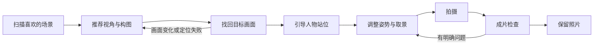

# 扫描选景与人像摄影 Agent 实施计划

日期：2026-10-01；进度补充：2026-10-02。本文描述完整目标，实际完成状态以执行计划为准。

开发批次、改动范围和验收清单见 [开发执行计划（2026-10-02）](CAMERA_SCAN_AGENT_IMPLEMENTATION_PLAN.md)。

已确认的产品目标：朋友帮拍，一人持机、一人入镜；沿用现有云端＋离线路由，优先保证云端体验。首版围绕单人环境人像，用户可以只扫一小片场景，也可以接近一圈或超过一圈。

补充约束：用户点击“开始扫描”后才采集本次扫描，按钮变为“结束扫描”；点击结束后停止采集并启动 Agent。商业化人像方向及规划时的文字/姿势/表情不一致诊断见第 13–17 节。P1 的通道映射、最终参数指导和布局回传已实施并完成代码验证；真机视觉质量待用户验收，后续扫描流程和专业素材尚未交付。

## 1. 产品目标与当前缺口

目标是：从用户实际扫描到的景物中，找到更适合当前人物和拍摄偏好的视角，并持续指导两个人完成一张照片。

“最适合”限定为**本次扫描范围、当前设备与用户偏好内的推荐**。扫描没有覆盖的地方不参与排名；审美没有唯一客观答案，保留换方案和用户指定背景的入口。

当前源码已经具备以下基础：

| 能力 | 实际入口 | 本次如何复用 |
| --- | --- | --- |
| 冻结、裁剪、旋转、拍照保存 | `camera/VlmCameraController.kt` | 保留单张构图模式；新增连续分析与关键帧采集 |
| 单图输入、区域云端路由和离线调用 | `model/CompositionModels.kt`、`data/VisionModelProvider.kt`、`data/MnnProvider.kt` | 扩展多图能力声明和版本化扫描协议 |
| 摄影意图、有限校验和修正 | `agent/DirectorAgent.kt`、`DirectorPrompt.kt` | 作为选中视角的方案生成子任务 |
| 受控人像姿势与几何映射 | `CompositionIntentMapper.kt`、`PlanValidator.kt` | 继续限制可执行姿势；补充背景约束与执行条件 |
| GLB 人偶和实际投影检查 | `avatar/` | 复用为姿态示范和屏幕目标参考 |
| MVI 会话、异步令牌、方案版本 | `ui/VlmContract.kt`、`VlmCameraViewModel.kt` | 扩展扫描与引导会话状态 |

关键缺口：当前 `SceneSnapshot` 和网关请求都只有一张图；相机没有绑定 `ImageAnalysis`；方案没有关联扫描方向和背景锚点；应用后只是恢复实时相机、设置倍率并叠加参考；`CaptureFinished` 只返回错误信息，没有照片 URI 和成片评估。

当前离线 JNI 输出预算是 **96 token**，导演对本地最多调用一次、云端最多两轮。离线主要是短场景观察再由客户端映射备选。规划不能把它当成已经支持多图全景比较、实时视频推理或完整空间测量。部分历史文档的模型预算和人偶说明与源码不一致，实施时以源码为准。

## 2. 用户的完整体验



1. 用户点击“开始扫描”，按钮变为“结束扫描”，提示原地缓慢扫描喜欢的场景；只在这个明确的时间窗口内收集关键帧，随时可以结束。不要求扫满 360°。
2. 用户点击“结束扫描”后，立即停止向本次扫描新增帧，固定扫描输入，然后启动 Agent。App 自动给出一个主推荐，例如“以山体为背景的环境全身照”，附实际扫描帧、人偶参考和一条具体理由；其他视角收起为备选。
3. 持机者按方向箭头转回选中的背景；接近后用背景轮廓或半透明参考对齐。方向到达和画面对齐是两个不同条件。
4. 确认取景后，入镜者按目标轮廓站位。指令明确标注“持机者”或“入镜者”，一次只说一个动作。
5. App 根据实时画面依次修正人物位置、大小、背景遮挡和姿势；稳定后提示可以拍摄，用户按快门。
6. 对真实照片检查清晰度、曝光、裁切与目标构图。给出具体问题或建议保留；用户可选择重拍、忽略建议或换背景。

示例只用于说明交互，不是对任何实际扫描图的分析：

> 持机者：向右转，直到山峰轮廓与参考对齐。
>
> 入镜者：移动到画面左侧的轮廓处，先保持自然站姿。
>
> 持机者：稍微抬高手机，让地平线离开人物头部。
>
> 入镜者：身体侧向山景，头轻轻转回镜头。
>
> 当前画面已稳定，可以拍摄。

左右采用明确参照：站位写“画面左侧”；身体动作写“你的左肩”。首版为后置相机，后续前置相机需要另外处理镜像与方向文案。

## 3. 扫描建模：支持 45°、340°、超过一圈

### 3.1 记录视角集合，而不是只记录旋转总量

每张关键帧记录：帧 ID、时间戳、相对相机朝向、俯仰、横竖屏、相机配置版本、倍率、裁剪变换、画面质量和视觉特征。首版称为“视角记忆”，不声称是完整三维地图。

同时维护两个不同值：

- 累计转动量：用于诊断轨迹；来回转和多圈可能持续增加。
- 有效视场覆盖：可靠关键帧实际覆盖的方向集合，去重后更新。能拿到可信视场角时合并方向区间；拿不到时显示已记录视角，不显示伪精确的覆盖度数。

| 扫描行为 | 处理方式 |
| --- | --- |
| 转动约 45° | 比较局部视角；同一背景也可以比较留白与构图，不要求额外绕圈 |
| 转动约 340° | 比较已记录视场；不简单宣称遗漏了 20°，因为镜头视场有宽度 |
| 超过 360° | 按朝向与视觉匹配合并重复视角，保留更清晰或遮挡更少的新帧 |
| 左右来回扫描 | 保持方向集合去重，累计转动量不用于扩大覆盖 |
| 向上、向下扫 | 朝向与俯仰一起分桶；保留天空、山体、地面等不同可见区域 |
| 边走边扫 | 检测明显视差、匹配失效或用户主动标记换机位后，划分新片段；同方向不等于同机位 |

首版默认提示原地扫描。没有空间定位时，不能保证可靠检测所有平移；一旦不确定，降低定位置信度，找回画面时重新确认，不能仅凭陀螺仪给出返回位置的路线。

### 3.2 传感器与视觉共同工作

使用旋转向量的四元数或旋转矩阵跟踪相对姿态，转换到相机光轴，再结合屏幕旋转；不要直接把手机顶边的罗盘角当作镜头朝向。水平朝向越过 ±180° 时展开，近乎直上直下时不使用不稳定的水平角。

可优先评估 `TYPE_GAME_ROTATION_VECTOR`：它适合相对转动、受磁场变化影响较小，但存在漂移。通过重复场景的视觉匹配校正相对方向；匹配失败时降低可信度，传感器缺失则退化为视觉关键帧。依据：[Android 位置传感器](https://developer.android.com/develop/sensors-and-location/sensors/sensors_position)。

图像与姿态按时间戳关联，核对时钟来源后插值；重绑相机、屏幕旋转、倍率和镜头切换均更新配置版本，防止使用旧变换。

### 3.3 关键帧与资源控制

新增 CameraX `ImageAnalysis`，使用 `STRATEGY_KEEP_ONLY_LATEST`；分析线程快速复制所需数据并关闭 `ImageProxy`，VLM 只读取独立图片，不持有相机帧。依据：[CameraX 图像分析](https://developer.android.com/media/camera/camerax/analyze)。

采帧由方向变化、视觉内容变化、画面质量提升或用户标记共同触发；时间只作为补充条件。先剔除严重模糊、过曝和重复帧，再按方向与场景保留多样性。纯语义相似度容易合并两座相似建筑，去重还应使用局部匹配和姿态关系。

建议起始配置：每 10°–15° 评估一次新视角，磁盘保留最多 32 张代表帧，首轮云端输入最多 8–12 张。全部是待真机调优的参数，不是固定产品承诺。短扫描可以只有 1–3 张，不填充重复图片凑数量。

同时限制扫描时长、图片总字节数和缓存占用；达到硬预算后暂停新增采集并提醒结束，或在预算内替换低价值帧，用户喜欢的背景优先保留。不能因为预算到达而自动启动 Agent，启动仍以用户点击“结束扫描”为边界。缓存保存文件与缩略图，不常驻全部高清 Bitmap。不把整段扫描视频逐帧交给 VLM。

## 4. 如何选出适合人像与环境的构图

采用“观测证据 → 比较候选 → 生成构图 → 验证可执行性”的顺序。用户标记的背景与明确偏好优先于通用审美评分。

### 4.1 先筛出值得比较的背景

端侧质量检查剔除不可用帧，但保留各方向代表，避免把有审美价值的逆光场景仅因亮度剔除。云端使用带帧 ID 的多图输入，比较背景与人物的组合潜力，返回至多三个互有差异的视角。

| 比较维度 | 需要的证据 |
| --- | --- |
| 环境识别与叙事 | 山峰、建筑、水面、路径等可见主体，有没有值得保留的形态 |
| 人物容纳空间 | 前景留白、可能的站位区域；缺少地面证据时标记未知 |
| 人景分离 | 人物可能出现的位置是否过于杂乱，与背景亮暗、色彩是否容易混在一起 |
| 环境保留 | 预计人物大小与位置会不会挡住主景物、地平线或引导线 |
| 光线可用性 | 可见光照倾向；脸部实际光照要等人物入镜后再确认 |
| 执行成本 | 当前设备是否能取到画面，是否需要移动、换镜头或大量重新取景 |
| 用户意图 | 喜欢的景物、环境占比、自然或有表现力的姿态 |

可以使用可解释的加权排序，但权重须通过实际照片比较校准；模型自报的“95 分”或“0.9 置信度”不能直接当真实审美或概率。几何投影通过也不代表姿势好看、真实人物适合或地面可站立。

### 4.2 选景与单视角构图分别建模

`ViewCandidate` 表示一个背景/视角，关联原始关键帧和方向；`CompositionPlan` 表示该视角内的人物布局、景别与姿势。先默认选中主视角，再复用当前导演生成三种构图，主方案展开，其他收起。不要一开始生成“三个背景 × 三个人像方案”的九张预览。

每个推荐需要包含：

- 来源关键帧 ID、可见背景主体及相应证据区域。
- 需要保留的背景区域、候选人物区域、已知限制和待确认项。
- 景别、相机倍率、人物屏幕位置与高度、允许的受控姿势。
- 找回该视角的方法，以及持机者、入镜者分别需要做什么。
- 完成条件，例如背景匹配、人物位置与比例稳定；不是只有一段建议文字。

当前 `LEFT/CENTER/RIGHT` 映射比较粗。后续让 VLM 提出语义区域和候选框，再经客户端检查、必要的视觉细化与用户确认，生成最终目标区域；不能直接信任模型给出的像素或脚点。候选区域必须绑定具体帧与裁剪坐标，换视角后重新映射。

普通单目扫描不能从人物高度比例可靠推导米数。首版指导“移动到参考轮廓”“调整到目标大小”，不用“向后走 2.4 米”。人物尚未入镜时，也不根据风景推断她的脸部光照、体型和身份。

## 5. 构成完整 Agent 的控制方式

建议新增一个会话级 `PhotoSessionController`，持有目标、已知证据、选中方案、执行阶段与任务预算。它调用摄影规划器和视觉工具，依据工具观测推进步骤。`DirectorAgent` 保持为生成/修正构图的子任务，不把其现有两轮循环改成无上限聊天。

| 子任务或工具 | 输入与输出 | 完成条件 |
| --- | --- | --- |
| `collect_scan` | 图像＋姿态 → 带质量标记的视角集合 | 用户结束，有可用帧 |
| `rank_views` | 代表帧＋偏好 → 推荐视角与证据 | 所有帧 ID 有效，理由有来源 |
| `generate_composition` | 选中视角 → 摄影意图与校验后方案 | 结构、背景约束、投影通过 |
| `match_target_view` | 实时背景＋参考帧 → 匹配与误差 | 视觉匹配可信且画面稳定 |
| `observe_subject` | 实时图像 → 人物框、关键点、质量 | 人物身份已选，观测可用 |
| `next_guidance` | 目标＋误差＋历史动作 → 一条指令 | 有明确接受对象及验证条件 |
| `capture_photo` | 用户快门事件 → 照片 URI | 保存成功且归属当前会话 |
| `evaluate_capture` | 真实照片＋目标 → 问题与依据 | 可评估项完成，未知项明示 |

这些是受限业务工具，不是多模型互相聊天，也不需要多个独立 Agent 服务。大模型负责较慢的选景、解释和必要的重规划；端侧视觉与确定性控制负责频繁的定位、误差检查和指令排序。

规划中的阶段：

```text
LIVE → SCANNING → SELECTING → PLAN_READY
     → ALIGNING_VIEW → POSITIONING_SUBJECT → GUIDING_POSE
     → READY_TO_CAPTURE → CAPTURING → REVIEWING → COMPLETED
```

显著画面变化返回找回视角；目标不可实现返回选景；取消停止相关任务；用户忽略建议可以继续手动拍摄。不能让评估分数成为永久无法拍照的门槛。

需要任务状态，且区分：已完成、等待用户动作、观测不可靠、目标不可实现、用户取消。例如“人物到位”的观测不能代表“相机到位”。

## 6. 实时指导的实施策略

### 6.1 先找回背景

相对姿态提供粗方向箭头；接近时用背景特征匹配验证。人物遮挡后在背景区域匹配，镜头切换、变焦、横竖屏或换持机者后重新建立匹配。

局部特征和几何一致性适合检查近似同机位的背景。山体、水面、树叶、游客和明显视差会导致匹配不稳定，不能始终用一个平面单应矩阵解释全部场景。失败时提供参考缩略图让用户对齐，不制造空间定位成功的状态。

### 6.2 再引导人物

新增轻量人物检测/姿态分析接口，首版先支持人物框、中心、画面占比和可见关键点。可借鉴旧 ONNX v2 模块的检测适配与坐标逻辑，但不直接把整个旧模块挂回入口；具体模型在目标手机上实测后选定。

实时指令优先级：取景失配 → 人物未入镜 → 人物位置/大小 → 主景物被挡 → 景别裁切 → 支持检测的姿势 → 拍摄稳定。每次只输出最需要解决的一项，解决后再推进，避免同时要求转相机和移动人物造成反复纠偏。

指令采用误差阈值、滞回区间、稳定时间和提示冷却。人物短暂丢失时等待重检；多个人出现时让用户点选目标并跟踪，目标丢失后不自动改选路人。左右动作要测试屏幕方向与人体左右的不同含义。

半身与特写允许脚部不在画面，验收按景别处理。细微表情、手指、回眸和精确身体旋转只在有可靠观测时判断；否则人偶示范并让持机者确认，不把二维关键点当完整三维姿态。

建议端侧引导先以 5–10 次/秒为调优起点，模型规划不按帧调用。实际频率依据耗时、热状态和电量调整；UI 继续正常显示相机预览。

分析图、方案图、预览图和保存照片建立明确坐标变换，统一裁剪与旋转，处理 EXIF。变焦不能直接沿用旧像素框。依据：[CameraX 坐标变换](https://developer.android.com/media/camera/camerax/transform-output)。

### 6.3 人偶的作用

保留 GLB 做姿势示范，实时叠加目标轮廓、人物框与偏差箭头。首版人偶是屏幕参考；方向不匹配时暂停位置验收，不让固定轮廓假装贴在现实地面上。

初版不靠每帧重渲染 GLB 完成跟踪。方案预览和姿势改变时按需渲染，实时误差主要以轻量覆盖层展示。

## 7. 云端与离线的能力边界

网关新增版本化的多图扫描接口与任务类型，例如 `/v2/director/step` 的 `RANK_VIEWS/GENERATE_PLAN/REVIEW_CAPTURE`；保留当前 v1 单图路径。能力接口增加 `multiImage`、图片数量/字节预算和支持的输出模式。

多图请求携带 `scanId`、`frameId`、相机配置及观测摘要。响应只能引用本次发送的帧，校验不存在的 ID、重复候选、跨帧坐标和缺失证据。供应商适配层需要分别验证多图输入，不能因为单图可用就假定多图也可用。

网关仍负责一次模型任务，Android 持有完整会话。切换供应商继续同一份任务与证据；不共享模型原始思考。延续已有内容拒绝、取消和参数错误不自动切换的规则。

| 模式 | 首版行为 |
| --- | --- |
| 云端多图可用 | 跨代表帧比较，选择主视角，再生成构图；完成拍后语义检查 |
| 云端只有单图 | 降级为用户选背景＋现有单图导演，明确跨视角比较未完成 |
| 自动模式云端失败 | 保留扫描帧，切换离线能力，不清空会话让用户重扫 |
| 强制离线 | 端侧筛质量与去重，用户选背景，单次短场景观察生成备选；实时指导用端侧视觉 |

离线首版不批量串行调用几十次当前 2B 模型来模拟多图排名，不宣称获得全范围最佳背景。后续可在资源测试后增加轻量审美模型或有限的多图推理。

建议初始云端预算：选景 1 次，沿用导演生成最多 2 次，拍后语义评估 1 次，共最多 4 次模型决策；另给传输失败后的切换最多 2 次，总请求尝试最多 6 次。由会话控制器统一计数，不能因子任务、重新规划或切换而重置。工具校验不消耗模型决策，用户明确换方案/重试可开启新的有限任务预算。

具体超时与预算需跟现有 70 秒请求超时、真机耗时协调；展示真实处理阶段，允许取消。上述预算是建议配置，不能当秒级完成承诺。照片检查先用端侧确定性结果，云端失败也能保存和结束。

扫描图片按现有云端模式发送，界面交代多张图的使用范围；临时帧在会话结束或过期后清理，日志不记录图片、密钥和用户原文。只上传代表帧与必要区域，服务端不默认保存扫描图。

## 8. 拍后检查与有限重拍

把拍照结果从“是否成功”扩展为 `captureId + sessionId + planRevision + photoUri`。读取这张真实照片，独立检查曝光、清晰度、人物裁切、背景主体保留与目标偏差；原始照片保留在相册，评估不能自动删除。

技术质量可端侧检查；眨眼、表情和姿势等项目依据输入分辨率及实际检测能力决定是否评估。全身环境人像脸部太小时，眨眼状态为未知。VLM 评价须指向具体可见问题，不以一个笼统审美分触发重拍。

首版建议最多给一轮自动整理的重拍建议，由用户决定是否执行。连续相同纠偏仍无改善时停止重复，显示参考或允许换方案。新的人物、游客遮挡或光线变化使原方案失效时，明确重新规划范围。

用户可以选择“更喜欢环境占比大”“姿势自然”等明确偏好，在后续推荐中使用；个人偏好不是闭环第一版的前置依赖。

## 9. 建议代码结构与协议

继续在 `feature-camera-vlm` 内实现拍照 MVI，不新建大量模块。建议增加以下职责边界，文件名在实施时再确定：

| 位置 | 新增或调整职责 |
| --- | --- |
| `camera/` | `ImageAnalysis`、姿态采样、关键帧收集、图片与传感器同步、相机配置版本 |
| `model/` | `ScanSession`、`ScanFrame`、`ViewCandidate`、`SceneEvidence`、`GuidanceAction`、`CaptureAssessment` |
| `agent/` | 会话控制器、视角排名、观测验证、引导决策、任务预算；复用现有构图导演 |
| `vision/` | 背景匹配、人物检测与跟踪、姿态和技术质量检查的可替换接口 |
| `data/` | 扫描帧缓存、多图网关适配、能力路由与轻量会话元数据 |
| `ui/` | 扫描、选景、背景对齐、人物指导、成片检查状态与覆盖层 |
| `services/vlm-gateway/` | v2 请求/响应校验、能力声明及供应商多图适配 |

关键契约：所有动作包含接收对象、参数、来源证据、前置条件、完成条件和过期条件；所有结果绑定 `sessionId/taskId/frameId/planRevision/configVersion` 中相应的标识。图像快路径不把 Bitmap 持续送进 MVI reducer，仅上报抽样观测摘要。

`CompositionPlan` 保留已有裁剪、倍率和人物参数；新增扫描关联和背景约束，避免把摄影方向强塞进 `avatar.yaw`。模型的候选坐标、客户端校验后的目标坐标、现实空间坐标明确区分。

所有新增用户可见固定文案定义在模块 `res/values/strings.xml`；枚举和误差由客户端映射为模板，避免模型每帧自由生成文案。

横竖屏保留会话，但重新建立视口映射；后台暂停分析和语音，返回后重定位；进程回收默认恢复轻量提示并重新扫描，不复活丢失的 Bitmap、相机资源或任务。未完成生成不得迟到覆盖用户的新选择。

## 10. 分阶段交付与验收

| 阶段 | 交付内容 | 可观察验收条件 |
| --- | --- | --- |
| M0：验证基础假设 | 扫描/指导数据契约；目标设备上的姿态、背景匹配、多图输入小范围验证 | 找到方向符号、屏幕旋转和时间同步错误；确认云端实际多图能力，记录耗时与内存 |
| M1：扫描与选景 | 任意角度扫描、去重缓存、云端比较、主视角、复用三方案、找回背景 | 45°、340°、多圈和来回扫描都能结束；主推荐引用真实扫描帧；重复扫描不无界增长；方向提示经过画面确认 |
| M2：人物执行 | 目标人物选择、检测跟踪、位置/比例纠偏、支持的姿势提示、稳定拍摄提示 | 持机者与入镜者指令区分；无冲突与抖动；人物丢失不换成路人；景别验收正确 |
| M3：闭环与恢复 | URI 回传、真实成片评估、有限重拍、预算、取消/切换/后台恢复 | 能完成扫描到保存与评估；发现问题回到对应步骤；断网降级、迟到结果和状态恢复正确 |
| M4：空间增强 | 单独验证 ARCore/深度、地面定位、空间锚定与遮挡 | 支持设备上真实空间定位可用；不支持设备保留前述体验 |

完整首版闭环以 **M1–M3 完成**为验收，M1 只是扫描选景里程碑。M4 后置，避免让首版依赖三维重建。

ARCore Depth 需要运行时检查支持，深度主要由运动计算并可能融合硬件传感器，纯原地转动不应被当成可靠测距保证；官方共享相机方案使用 Camera2，接入现有 CameraX 必须单独验证资源与生命周期。依据：[ARCore Depth](https://developers.google.com/ar/develop/java/depth/developer-guide)、[共享相机](https://developers.google.com/ar/develop/java/camera-sharing)。

## 11. 验证清单与衡量方式

后续实现时编写或更新自动化测试，由用户在本地运行；本次仅规划，不运行 Gradle/Android 测试。

- 扫描：±180° 跨界、多圈、反向、重复景物、相似但不同的景物、俯仰、模糊、时间戳错位、缺传感器与缓存上限。
- 协议：虚构帧 ID、跨帧坐标、错版本、重复候选、能力不足、多图字节上限、路由与总预算。
- 引导：取景失配、倍率变化、人物遮挡/丢失/多人、左右参照、全身与半身裁切、提示滞回与稳定门控。
- 会话：取消、离开页面、横竖屏、后台返回、进程重建、迟到评估、重复快门、用户手动忽略建议。
- 成片：评估绑定真实 URI；低分辨率脸部不给出确定眨眼结果；原图保留；无明确改善时停止重复指导。

建立真实扫描回放集：山景、湖面、建筑、林间、逆光、人群；包含不同手机、扫描角度与拍摄人物。先人工标注可用关键帧、背景匹配、人物目标及不可评估项，再评估算法。

主要产品指标：扫描到可用推荐的成功率、找回视角成功率、开始到拍摄的完成率、用户选择忽略/更换建议比例、无效纠偏次数、重拍率，以及用户对前后照片的偏好比较。技术指标记录端侧耗时和云端阶段 P50/P95、内存峰值、热状态、上传字节及单会话调用量，不只统计 JSON 合法率。

先用回放和真机建立基线，再确定数值门槛；当前没有足够设备与照片证据，不承诺时间或效果百分比。

## 12. 推荐的下一步

先修复已查明的文字/动作一致性和表情通道问题，并用少量专业姿势样片验证人像资产链路，具体见第 13–17 节。接着开展 M0 与 M1：新增扫描会话和连续分析，完成去重后的关键帧集、云端多视角比较以及找回目标背景，并接入构图导演。

同时把后续执行条件写进协议，防止只新增“扫描后生成三张卡片”的孤立功能。之后按 M2、M3 补齐实时人物指导和真实成片评估，形成可完成、可验证、可中止的摄影会话。

## 13. 开始/结束扫描的明确产品契约

| 状态 | 按钮与行为 | 资源行为 |
| --- | --- | --- |
| 实时取景 | 显示“开始扫描” | 不收集扫描关键帧、不上传、不调用构图模型 |
| 扫描中 | 显示“结束扫描”，提示扫描喜欢的周边场景 | 相机＋姿态采样；只做必要的轻量质量筛选和去重 |
| 点击结束 | 固定时间窗口与扫描帧集合，禁用重复提交 | 停止扫描采样；关闭或切换分析器，开始选景与构图任务 |
| 生成中 | 显示真实处理步骤，允许取消 | 有限云端任务；不继续把新环境追加到扫描 |
| 指导中 | 显示实时指导及拍照入口 | 实时帧用于验证已选方案，不属于扫描输入，也不默认上传 |

实现要点：

- `StartScan` 新建 `scanId`，记录开始时间；旧扫描帧不混入新扫描，旧任务结果不能覆盖新任务。
- `StopScan` 记录结束时间，关闭新增入口；按相机帧时间戳过滤区间外的帧。结束后到达的回调，只有采集时刻在窗口内且属于本次扫描才可进入最终整理。
- 结束时先固定符合窗口的关键帧，再排空有限的本地整理任务并生成不可变输入；不能用点击结束之后的新画面补充最后一帧。
- 没有可用帧时提示重新扫描或选择已有图片，不发起无图模型请求。快速点击、重复结束及扫描取消都有明确幂等处理。
- 应用退后台或相机被打断时暂停/终止扫描并提示用户处理，不悄悄分析未完成的扫描；硬预算到达也不替用户自动点击结束。
- 扫描期不启动 VLM 分析、人偶渲染、自动选景或云端上传；提前加载模型也不属于首版必需步骤。

用户主动控制时间窗口能排除开始前和结束后的环境；窗口内用户扫过的内容仍可能有不喜欢的部分，保留“标记喜欢”与删除关键帧的可选入口即可，不要求每次操作。

## 14. 当前人偶与文字不一致：已查明的问题

以下结论来自源码及四个内置 GLB 的静态检查；实际修复效果仍需真机渲染验收。

### 14.1 指导文字并非全部写死，但存在不同数据来源

云端的 `guidance/reason` 来自模型；“身体向左微转”等参数标签来自 `strings.xml`，固定标签本身是合理的本地化方式。真正的问题是文字和最终显示的动作可以各自变化。

- `CompositionIntentMapper.sceneFallback()` 使用一段短场景观察生成三种不同的动作，却把同一段 `description` 同时放进各方案的 `guidance/reason`。场景观察可以作为分析依据，但不能充当每个方案的实际操作指令。
- `distinct()` 可能修改方位或朝向以去重，`toPlan()` 又保留原来的 `intent.guidance`。原文字里提及左侧或朝向时，可能与修改后的方案冲突。
- 用户拖动、缩放人物后，实际布局也发生变化；指导必须重新派生，不能继续引用原有位置建议。
- UI 将细分动作和旧 `PoseId` 的归纳标签混合展示，旧编号不足以完整表达身体、手臂、头部的组合。

### 14.2 表情映射存在明确名称错误

`AvatarCatalog.expressionWeights()` 生成的名字包含 `blendShape1.` 前缀，而 GLB `extras.targetNames` 中没有这个前缀。左右通道的编号也不同，不能拼同一个编号生成左右名称。

| 当前代码引用 | GLB 中实际名称 |
| --- | --- |
| `blendShape1.AK_44_MouthSmileLeft` | `AK_44_MouthSmileLeft` |
| `blendShape1.AK_44_MouthSmileRight` | `AK_45_MouthSmileRight` |
| `blendShape1.AK_07_CheekSquintRight` | `AK_08_CheekSquintRight` |
| `blendShape1.AK_19_EyeSquintRight` | `AK_20_EyeSquintRight` |
| `blendShape1.AK_21_EyeWideRight` | `AK_22_EyeWideRight` |
| `blendShape1.AK_25_JawOpen` | `AK_25_JawOpen` |

已检查四个角色均有表情形变名称，但当前代码引用的上述通道完全匹配数量为零。渲染器用 `desiredWeights[names[index]] ?: 0f` 逐项精确查找，所以这些期望的表情权重会落为零。Filament 1.76.0 源码也直接读取 glTF 的形变名称，不会自动添加此前缀。依据：[Filament 资产加载源码](https://github.com/google/filament/blob/v1.76.0/libs/gltfio/src/AssetLoader.cpp)。

修复需要显式逐通道映射，并在资产加载时验证名称、索引和支持能力；不允许表情缺失时仍把“已显示微笑”报告给上层。验收包括权重实际生效和脸部渲染差异，不只检查枚举存在。

### 14.3 当前没有专业摄影动作库

四个 GLB 各只有一个动画定义，时间采样均只有一个关键点，并不是连续动作片段。当前渲染主要是在原始局部矩阵后叠加手写欧拉角，再更新骨骼矩阵。

这能表达有限变化，但不能稳定完成自然回眸、手贴腰部、跨步、坐姿、手指动作和不同体型的接触关系。没有完整的姿势设计、动作转移、脚底约束和动作质量验收。

另外，当前资源各约 12–18 MiB，四个合计约 60 MiB；文件大小不等于运行时内存，表情形变、纹理解码与 GPU 缓冲还需另测。新资产必须统一单位、轴向和包围盒，不能沿用当前为 Rocketbox 定制的 100 倍包围盒校正。

## 15. 商业版推荐：单一动作事实＋专业内容库

### 15.1 文字、人偶和实时验收共享同一份最终动作

建议引入 `ResolvedPhotoSpec`，作为校验后最终执行方案，包含视角、布局、角色/骨架版本、动作 ID、动作阶段、整体朝向、有限头部与手部调整、表情、适用条件和完成条件。

```text
场景与用户偏好
  → 检索适用的摄影姿势
  → VLM 选择动作与构图，提出受控调整
  → 能力与条件校验，解析为最终动作事实
  → 人偶渲染 / 操作指令 / 实时验收
```

其中：

- VLM 从当前角色实际支持的动作中选择，不能自由发明无法渲染的姿势或任意关节角度。
- 人偶读取最终动作 ID、动作阶段和参数；指导文字读取同一份数据，用本地化模板生成；检查器也读取同样的目标。
- 场景解释可以由模型生成，但可执行的身体、站位、左右和表情指令以最终方案为准。解释里包含动作事实时同样需要核对或重新派生。
- 校验器修改方位、倍率、姿势或动作阶段时，同时更新最终动作事实、文字、预览和 revision。
- 渲染器返回实际采用的动作、参数及降级原因；若降级为自然站姿，上层指令也同步变为自然站姿。关键动作无法执行时不提交成功方案。
- 模型不支持的坐姿、倚靠、扶栏动作，不能由渲染器偷偷替换成人物站立并继续显示原文。

指导文案使用模板并不等于推荐写死：不同场景选择不同动作、位置、景别与顺序；模板让“展示什么就教什么”可验证。复杂中文语义冲突不能仅靠关键词正则可靠解决，减少重复表达动作事实更稳妥。

### 15.2 摄影姿势库的内容规格

先制作 **5 个完整质量样片**验证管线，再扩展到 **30–50 个经过审核的基础摄影姿势**；这些数量是建议的交付规模，不是商业质量的判定标准。

基础分类：自然站姿、侧身、回眸、重心变化、前后脚、轻步行、轻抬手、整理衣物、望向景物、手靠脸侧。坐姿、倚靠和持物属于需要环境/道具支持的独立类别，条件没有确认时不推荐。

每个动作内容包至少包含：

- 稳定姿态或短动作片段、建议停留的拍照阶段、原始工程文件、最终 GLB/运行时姿态数据。
- 人体左右、整体朝向与头部注视的明确语义；动作可以支持的朝向/镜像范围。
- 摄影风格、适用景别、背景类型、环境与道具前置条件，以及不适用的情况。
- 与动作同步的步骤文案、示范缩略图和可检测的验收项。
- 骨架与资产版本、支持角色列表、表情兼容性、接触目标和质量记录。

动画师制作或调整动作，摄影师审核可模仿性与画面效果。相同动作在不同体型、服装、角色上分别检查；姿势数量乘以表情数量，不等于同样数量的合格摄影方案。

首版可采用一个成熟成年角色先验证完整链路；现有其他角色作为兼容路径，商业替换需逐角色验收。角色风格与新增资产采购在实施前由用户确定，本文不默认删除现有角色或采购模型。

### 15.3 姿势、表情和受控微调

身体采用审核后的完整姿态/动画；脸部采用显式映射的 BlendShape 表情；有限微调采用视线控制、头部约束和必要的 IK（给出手或脚的目标位置，由关节求解接近目标）。

手扶腰等接触优先在制作阶段烘焙；确有需求再增加运行时 IK。脚底、膝盖和关节范围、手指及衣服穿模必须检查。镜像也必须重新确认人体左右和动作/衣物非对称性。

Filament 1.76.0 已提供动画应用、过渡及骨骼更新接口，因此保留它可以播放专业动画。复杂的动作分层、骨骼蒙版、IK 和接触求解仍需额外实现或离线烘焙，不能把 `applyCrossFade` 当成完整角色动画系统。依据：[Filament 动画接口](https://github.com/google/filament/blob/v1.76.0/libs/gltfio/include/gltfio/Animator.h)。

表情先覆盖自然、轻微笑、开朗笑、沉思等摄影常用状态，并配少量强度档位。身体远景中的脸部很小，增加可展开的脸部示范，表情指导不会只依赖预览里几像素的脸。表情差异必须肉眼可识别；“自信”等气质标签要对应审核过的身体＋表情组合。

## 16. 技术与资产路线比较

以下是截至本次查阅资料的可选路线，当前未采购或安装任何软件。

| 路线 | 优点 | 实际代价 | 建议 |
| --- | --- | --- | --- |
| 自有/明确获授权的专业角色＋摄影动作库＋Filament | 易与原生相机结合；动作、文案和性能可控 | 需要角色/动画内容制作与资产验证 | 首选；专业资产可替换当前人偶，渲染器不必先更换 |
| Character Creator/iClone/ActorCore 制作管线 | 提供角色、面部绑定、动画及外部工具管线 | 需要移动端优化、材质转换、动作重定向和明确的 App 用途授权 | 可作为采购候选，不当作买完即能上线的完整 SDK |
| Blender＋定制/自有动作 | 姿势、形变、烘焙和导出可控制 | 依赖动画师或相应制作能力 | 推荐作为资产制作与标准化环节 |
| Unity 角色动画运行时 | 适合复杂动画与后续大规模 3D/AR 体验 | 原生相机、Compose、生命周期与运行时资源需要重整合 | 只有明显需要完整动画引擎时才考虑 |
| 专业二维示范图/短视频＋轮廓引导 | 展示质量容易控制、移动端成本较低 | 任意视角和实时三维微调能力较弱 | 可独立做商业版，也适合低端设备与动作教学补充 |
| 运行时让生成模型直接创造任意人像姿势 | 动作表述自由 | 一致性、接触、延迟、成本和可验证性未解决 | 不作为首版核心；可辅助离线制作，再人工审核 |

Blender 支持 glTF 的骨骼和形变动画，但制作中的约束/驱动等需要导出可支持的变换与形变，不会全部自动成为 Android 运行时能力。依据：[Blender glTF 文档](https://docs.blender.org/manual/en/3.6/addons/import_export/scene_gltf2.html)。

Character Creator 官方提供角色、面部绑定及 Blender 等外部工具管线；实际选用资产还须测试导出到 GLB 后的材质、骨骼和表情。当前 Reallusion 内容 EULA 对嵌入应用/服务、付费可下载内容和 AI 用途有专门限制，普通内容许可不能直接视为本 App 的完整授权；按“固定角色在摄影指导 App 内运行”的具体用途取得书面确认，必要时使用企业许可。依据：[产品能力](https://www.reallusion.com/character-creator/)、[内容 EULA](https://www.reallusion.com/Content/EULA/EULA.htm)、[许可分类](https://www.reallusion.com/license/content.html)。

Mixamo 可以作为动作素材来源之一，但不是完整摄影姿势/面部管线。Adobe 官方 FAQ 说明角色与动画可用于商业项目，同时说明中国国家代码的用户不能使用该服务，因此不作为面向大陆的默认制作依赖。依据：[Mixamo 官方 FAQ](https://helpx.adobe.com/creative-cloud/faq/mixamo-faq.html)。

Unity as a Library 的官方常规 Android/iOS 集成路径仅支持全屏渲染，并有运行时生命周期等限制；不能假设把它作为一个小型 Compose 人偶控件嵌入就能直接完成替换。依据：[Unity 集成限制](https://docs.unity.com/en-us/engine/6000.5/manual/platform-specific/cross-platform-features/unityasa-library)。

视觉风格建议采用轮廓清晰、面部可读、服装简洁的精致风格化或适度写实角色。是否追求照片级真人感由用户决定；逼真外观还涉及皮肤、头发、服装、灯光与性能成本，不应作为“商业级”的唯一指标。

## 17. 商业化实施顺序与质量门槛

1. **先修一致性缺陷。** 修正当前表情名称；从最终动作派生操作文案；方案去重、拖动、缩放及渲染降级同步更新展示。为这些问题编写自动化测试，不主动运行 Gradle/Android 测试。
2. **做五个完整动作样片。** 自然站立、侧身、回眸、手扶腰和轻步行停顿；配自然、微笑等代表表情。验证内容制作、GLB、Filament、文案与目标关键点的完整链路，支持手动选动作以隔离模型选择错误。
3. **落实扫描按钮与会话。** 严格开始/结束窗口、资源预算、多图选景、找回背景；模型只能检索/选择实际可用的动作与表情。
4. **扩展内容库并完成实时指导。** 优先覆盖常见旅游人像，逐角色验证；同时实现人物位置、比例和支持姿势的实时验收。
5. **真实成片与发布候选验收。** 完成成片检查、降级与会话恢复；以实际用户完成一次拍摄和照片偏好评估衡量结果。

五个样片通过后再扩大内容投入。已有内容库不能只用“骨骼名字齐全”作为合格判断：

- 模型支持：动作 ID、版本、骨架、形变通道和角色明确匹配，没有静默缺失。
- 指令一致：展示的身体/手部/头部/站位/表情与操作文案一致，用户修改及降级后仍一致。
- 姿势质量：重心、关节、手指、接触、脚底与衣物合理，各个开放朝向都有审核结果。
- 演示可读：全身/半身示范与脸部细节清楚；动作过渡自然，最终拍照阶段稳定。
- 场景适用：坐、靠、扶、持物都有已确认条件；环境主体未被目标布局明显遮挡。
- 移动端资源：确定目标设备，记录加载时长、渲染与分析耗时、GPU/CPU 内存和热状态；不按桌面渲染效果承诺手机性能。
- 闭环体验：用户能从扫描完成到找回画面、人物到位、拍摄与保存；定位或识别失败可继续手动拍摄，不陷入反复提示。

专业人像系统能显著提升完成度，但商业发布还需上述相机体验与闭环在真实设备、真实用户上成立。修复表情或买一个更漂亮的角色，本身不能证明产品已经满足发布质量。
